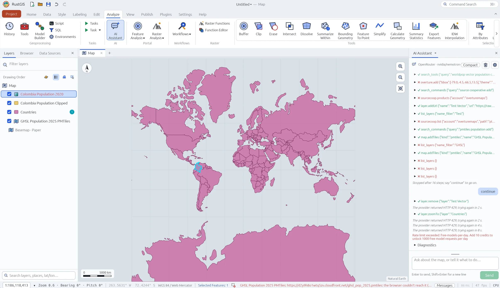

# Día 10 — Prompting only: ¿Dónde vive la mitad de Colombia?

Hecho solo con el AI Assistant de RustGIS en https://web.rustgis.app. Sin clics en el mapa ni en el
layout: cada cambio sale de un prompt. Los únicos clics son la entrega (exportar el layout y guardar
el proyecto). Los prompts van tal cual se escribieron, en orden; debajo de cada uno, lo que hizo el
asistente.

Datos: DANE, Censo Nacional de Población y Vivienda 2018, población total por municipio
(`portalgis.dane.gov.co`, servicio `Serv_Mpios_DistribucionPoblacionTotalCen_2018`, capa 4).

Proveedor y modelo del asistente:
- Provider: OpenRouter
- Model: nvidia/nemotron-3-ultra-550b-a55b:free (escrito a mano)
- Address: la que trae (https://openrouter.ai/api/v1)
- API key: la de openrouter.ai/keys

Antes, con Google Gemini (key gratis de AI Studio): el modelo por defecto `gemini-3.8-flash` dio
`HTTP 403 PERMISSION_DENIED` ("The caller does not have permission"); con `gemini-flash-latest`
pasó el permiso pero Google respondió `HTTP 503` en los tres reintentos (2, 4 y 8 s).

---

## 1 · El punto de partida

> Haz un mapa de dónde vive la gente en Colombia.

Qué hizo (OpenRouter, nemotron gratis):
- Buscó datos por su cuenta: `search_tools` ("worldpop vector population…"), luego
  `overture.add` ✗, `sourcecoop.products` ✗ y `sourcecoop.list` ✗ (Overture y Source Cooperative
  no corren desde el asistente en la web).
- Cargó una capa de prueba (`layer.addUrl` "Test Vector") y la quitó después.
- Añadió dos veces un PMTiles de GHSL Population 2025 (`map.addTiles`, CloudFront): no cargó,
  "the browser couldn't reach it" (sin CORS).
- `list_layers` falló cuatro veces (una con filtro "GHSL" y tres sin filtro) ✗.
- Se detuvo en el tope de 16 pasos ("Stopped after 16 steps; say continue"). Con "continue" hizo
  `layer.remove` y `layer.zoomTo` sobre "Countries" y se cortó con `HTTP 429`: "Rate limit
  exceeded: free-models-per-day. Add 10 credits to unlock 1000 free model requests per day".
- Quedaron en el mapa: Colombia Population 2020, Colombia Population Clipped, Countries (con
  Colombia seleccionada) y GHSL Population 2025 PMTiles (vacía), sobre el mapa base Paper. No hay
  un mapa de población de Colombia.

Lección: sin datos ni pregunta concretos, el asistente explora a ciegas y gasta la cuota gratis
del día sin producir el mapa. Captura de pantalla:

---

## Cambio de plan: Claude Code maneja RustGIS de escritorio

En la web, los niveles gratis no alcanzaron (Gemini: 403 y 503; OpenRouter: cuota diaria agotada
en el prompt 1). Desde el prompt 2, el trabajo sigue en RustGIS de escritorio (0.6.0) con
Claude Code conectado por MCP ("Let your Agents Control RustGIS"), sin API key: usa la
suscripción de Claude. El proyecto se guarda como `.rgis` y abre en web.rustgis.app porque los
datos entran por URL.

## 0 · Las reglas para Claude Code

> Vas a hacer un mapa en RustGIS, la aplicación de escritorio que tengo abierta, usando solo las
> herramientas del servidor MCP rustgis-app. No uses la terminal, ni Python, ni descargues archivos
> por tu cuenta: todo cálculo y todo dato pasa por RustGIS. Carga los datos con layer.addUrl desde
> su URL (no desde archivos locales) para que el proyecto abra igual en web.rustgis.app. Antes de
> cada paso grande, dime qué vas a hacer.

Qué hizo: se conectó a `rustgis-app` y leyó el proyecto abierto ("Untitled", mapa base "paper",
sin capas). No hizo nada más: preguntó qué mapa hacer (tema, zona, datos y salida) y no supuso
ninguno. Ojo: la sesión carga la configuración global del usuario (CLAUDE.md, memoria de engram),
por eso sabía de los días anteriores (Medellín, Bucaramanga, Colombia).

## 2 · Los datos y la pregunta

> Carga los municipios de Colombia con su población del censo 2018 desde
> https://portalgis.dane.gov.co/mparcgis/rest/services/INDICADORES_DE_POBLACION/Serv_Mpios_DistribucionPoblacionTotalCen_2018/MapServer/4/query?where=1%3D1&outFields=*&outSR=4326&f=pbf
> El campo CL0_TT_PERSN es la población. Ordénalos de mayor a menor población y dime cuántos
> municipios hacen falta para sumar la mitad de la gente del país.

Qué hizo (Claude Code + RustGIS escritorio, 1 min 36 s):
- Cargó la capa con `layer.addUrl` (PBF): 1122 registros.
- Resolvió la suma acumulada sin una herramienta para eso: "elegir los que superan una población es
  lo mismo que ordenar y tomar los N primeros". Con `selectByAttributes` (población ≥ umbral) y
  `summaryStatistics` sobre la selección, probó los dos lados del corte: los 26 más poblados suman
  21 934 918 (no llegan a 22 082 208,5) y los 27, 22 147 355 (sí). El 27 es Envigado (212 437).
- Respuesta: **27 municipios de 1122 (el 2,4 %) tienen más de la mitad de la gente.** Coincide con
  la comprobación en Python. Dejó los 27 seleccionados y una tabla auxiliar
  "Municipios CNPV 2018_Statistics".
- Avisó que la capa no tiene geometría: nada se dibuja. Propuso pedirla en GeoJSON o con
  `service.add`. Ninguna de las dos sirve: el servicio del DANE devuelve `geometry: null` en todos
  los formatos, y la capa 3 del mismo servicio tampoco trae geometría (comprobado con `curl`). No es
  un fallo de RustGIS.

## 3 a 6 · Lo que estaba planeado

Los prompts 3, 4, 5 y 6 se escribieron antes de empezar; en la práctica cada paso dependió de lo
que respondió Claude Code, así que se usaron versiones ajustadas. Están abajo, en orden, como se
escribieron.

---

## Los prompts que se usaron

Lo que se escribió de verdad después del prompt 2, en orden, sin borrar nada.

### 2b · La geometría (después del prompt 2)

> El servicio del DANE no entrega geometría en ningún formato. Carga los polígonos de los municipios
> del Marco Geoestadístico Nacional 2025 desde
> https://portalgis.dane.gov.co/mparcgis/rest/services/MGN2025/Serv_CapasMGN_2025/FeatureServer/317/query?where=1%3D1&outFields=MPIO_CDPMP,MPIO_CNMBRE,DPTO_CNMBRE,MPIO_NAREA&outSR=4326&maxAllowableOffset=0.005&f=geojson
> y únele la población por código: MPIO_CDPMP con MPIO_CCDGO. Dime cuántos municipios quedaron sin
> población después del join.

Qué hizo:
- Cargó el MGN 2025 (1122 polígonos, una página) y revisó la cobertura y el tipo de las claves
  antes de unir.
- `joinField` con fallo ante códigos repetidos. El primer join unió solo 27 municipios: habían
  quedado seleccionados del cálculo anterior, y el join trabaja sobre la selección. Lo notó solo,
  borró esa capa, vació la selección con `select.byAttributes` `1=0` (no encontró un comando para
  quitar la selección) y repitió el join.
- Resultado: 1121 de 1122 unidos, sin códigos repetidos; capa "Municipios MGN2025 + Pob2018".
- Sin población: Nuevo Belén de Bajirá (Chocó, 27493, 1289 km²), municipio creado en 2022.
- Con un join inverso encontró el que sobra en el censo: Mapiripana (94663, Guainía, 1011 personas
  en 2018), que no existe en el MGN 2025. Borró la capa de comprobación.
- Advirtió que los municipios de los que salió Bajirá tendrían población de un territorio más grande
  (importa para densidad, no para los 27).

### 3b · El mapa (en lugar del prompt 3)

> Representa los 27 municipios que suman la mitad del país frente al resto. Bajirá va en gris como
> el resto; basta una nota en la fuente: "Nuevo Belén de Bajirá (creado en 2022) no tiene dato en el
> censo 2018; Mapiripana (1.011 personas) no está en el MGN 2025". En la capa unida, crea un campo
> Mitad con 1 en los municipios con población ≥ 212.437 y 0 en el resto. Pinta Mitad = 1 de un color
> fuerte y el resto en gris claro, con bordes finos y discretos. Quita el mapa base.

Qué hizo:
- Campo Mitad (27 con 1, 1095 con 0); Mitad = 1 en rojo #D7263D, el resto (Bajirá incluido) en
  gris #E4E4E4; bordes blancos semitransparentes de 0,25 pt; sin mapa base.
- Como "la fuente" solo cabe en un layout, **lo creó sin que se lo pidieran**: A4 vertical "Mitad de
  Colombia", 1:12 000 000 con San Andrés; título "La mitad de Colombia vive en 27 municipios";
  subtítulo "27 de 1.122 municipios suman 22.147.355 de las 44.164.417 personas censadas en 2018";
  fuentes (CNPV 2018 y MGN 2025 del DANE) con la nota; leyenda "Censo 2018", localizador, norte y
  escala; cambió a español los encabezados de la plantilla ("Fuentes", "Referencia").
- Dijo que no puede ver la composición (por MCP solo ve el mapa) y pidió revisar la firma (la
  plantilla pone "Made with RustGIS · fecha"), el texto de referencia (quizá en inglés) y que la
  nota quepa. No exportó ni guardó: pidió rutas.

Revisión del usuario sobre la captura: leyenda sin símbolos (solo el nombre de la capa),
localizador vacío (globo sin países), San Andrés casi invisible, referencia en inglés, retícula
encima del país y chocando con la escala, firma de plantilla.

### 4-5 · Área y ajustes del layout (en lugar de los prompts 4 y 5)

> ¿Qué porcentaje del área de Colombia ocupan los 27 municipios? Usa MPIO_NAREA. Luego ajusta la
> composición:
> 1. Renómbrala "Día 10".
> 2. Subtítulo: "27 de 1.122 municipios suman la mitad de las 44.164.417 personas censadas en 2018
>    y ocupan el X % del territorio".
> 3. La leyenda debe mostrar dos clases con su color: "Los 27 municipios que suman la mitad" (rojo)
>    y "El resto del país" (gris). Sin el nombre de la capa.
> 4. Quita el localizador y la retícula.
> 5. San Andrés y Providencia en un recuadro aparte, en la esquina superior izquierda, y el mapa
>    principal encuadrado solo en el territorio continental.
> 6. Referencia en español: "Proyección: Web Mercator · Datum: WGS 84".
> 7. Firma: "José Gregorio Rincón Albarracín · Hecho con RustGIS (rustgis.app) solo con prompts,
>    usando Claude Code · #30DayMapChallenge Día 10: Prompting only".

Qué hizo: área **2,6 %** (coincide con la comprobación); los siete ajustes hechos, incluido un
segundo marco de mapa para San Andrés y Providencia; mapa principal a 1:11 000 000.

Revisión del usuario (criterio cartográfico): la convención es un recuadro por isla, no uno para
las dos (a 90 km de distancia quedan diminutas); y la grilla, sin ser obligatoria, mejora el mapa si
no hace ruido.

### 5b · Dos recuadros y la grilla

> Ajusta la composición "Día 10":
> 1. Cambia el recuadro de San Andrés y Providencia por dos recuadros separados, uno encima del otro
>    en la esquina superior izquierda: "San Andrés" y "Providencia y Santa Catalina", cada uno
>    encuadrado en su isla y con su escala numérica.
> 2. Vuelve a poner la grilla solo en el mapa principal, cada 5°, con líneas finas gris claro
>    (0,25 pt, semitransparentes) y las etiquetas de coordenadas fuera del marco. Que no choque con
>    la escala ni con la leyenda.
> 3. Cambia el gris del resto del país a #D4D4D4.

Qué hizo: dos recuadros (Providencia y Santa Catalina arriba, 1:500 000; San Andrés abajo,
1:600 000, en su orden geográfico); grilla de 5° gris claro con etiquetas fuera del marco, a la
izquierda y abajo, con "O" de oeste; gris #D4D4D4.

### 6 · En inglés y entrega

> Duplica la composición "Día 10" como "Day 10" y traduce sus textos: título "Half of Colombia lives
> in 27 municipalities"; subtítulo "27 of 1,122 municipalities hold half of the 44,164,417 people
> counted in the 2018 census and cover 2.6% of the territory"; "FUENTES" → "SOURCES" con las fuentes
> y la nota en inglés; "REFERENCIA" → "REFERENCE", "Projection: Web Mercator · Datum: WGS 84"; los
> nombres de los recuadros, "San Andrés" y "Providencia and Santa Catalina"; firma "José Gregorio
> Rincón Albarracín · Made with RustGIS (rustgis.app) using prompts only, with Claude Code ·
> #30DayMapChallenge Day 10: Prompting only". Las clases de la leyenda déjalas en español. Después
> exporta "Día 10" a ~/Developer/30dmc-2026/results/day-10/day-10-es.pdf y "Day 10" a
> ~/Developer/30dmc-2026/results/day-10/day-10-en.pdf, y guarda el proyecto como
> ~/Developer/30dmc-2026/results/day-10/day-10.rgis.

Qué hizo: la composición en inglés, los dos PDF y el proyecto. El `.rgis` (3,1 MB) guarda las capas
dentro, sin URL de origen: el join solo existe en el proyecto.

Al abrirlo en web.rustgis.app: el mapa, el join y los recuadros cargan, pero los textos salen en otra
fuente. RustGIS lee las fuentes del sistema (`crates/render/src/fonts.rs`): en macOS usa San
Francisco con seminegrita; en la web, sin acceso a esos archivos, usa Ubuntu Light. El título
pierde la negrita y el subtítulo, más ancho, se sale de la página.

### 7 · El subtítulo en dos líneas

> En las dos composiciones, parte el subtítulo en dos líneas para que quepa con cualquier fuente.
> "Día 10": "27 de 1.122 municipios suman la mitad de las 44.164.417 personas censadas en 2018" /
> "y ocupan el 2,6 % del territorio". "Day 10": "27 of 1,122 municipalities hold half of the
> 44,164,417 people counted in the 2018 census" / "and cover 2.6% of the territory". Si hace falta,
> baja el subtítulo hacia el mapa para que no se encime. Después vuelve a exportar los dos PDF y
> guarda el proyecto en las mismas rutas.

Qué hizo: el subtítulo en dos líneas en las dos composiciones, PDF y proyecto de nuevo. En la web ya
cabe; el título sigue sin negrita allí.

## Comprobación

Cifras esperadas (réplica en Python, 2026-11-10): 44 164 417 personas; 27 municipios suman el
50,1 % (el 27 es Envigado, 212 437); ocupan unos 29 100 km², el 2,6 % del país.

Lo que dio Claude Code con RustGIS: 27 municipios, 22 147 355 personas (26: 21 934 918), el 27 es
Envigado (212 437); área 2,6 %. Coincide.
